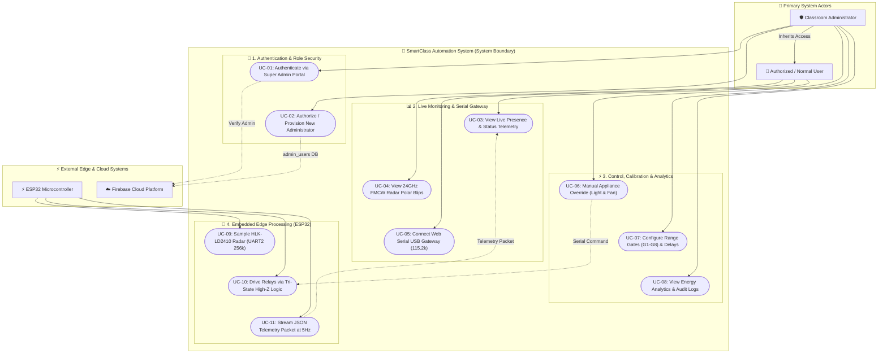
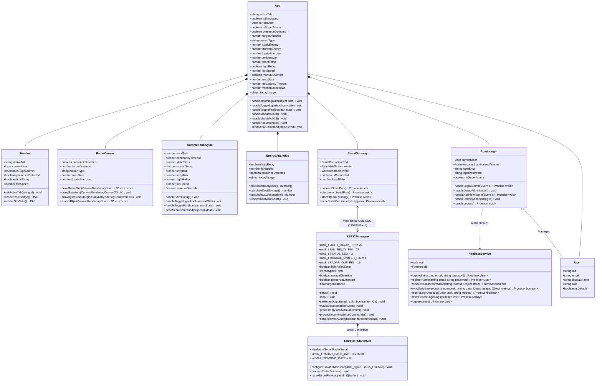
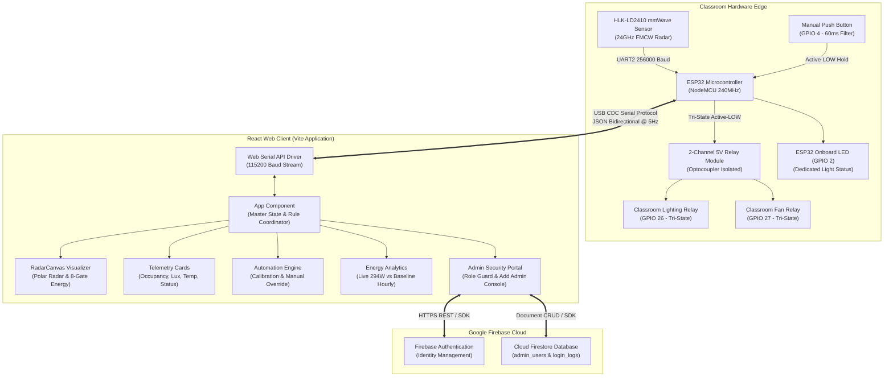
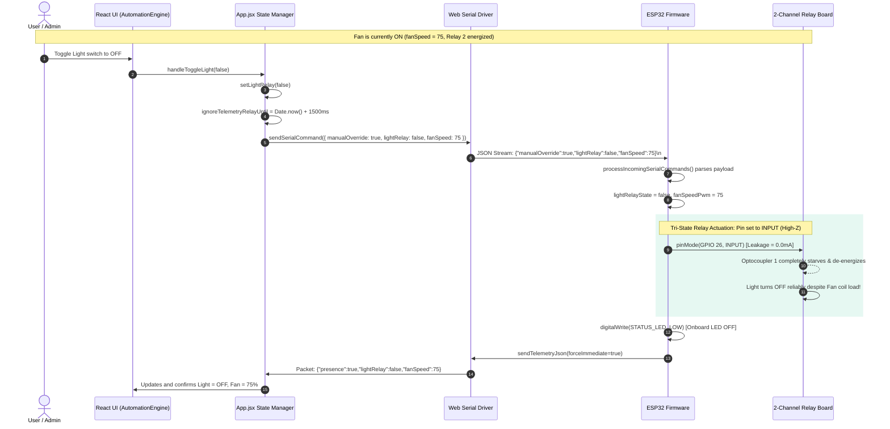

# SmartClass mmWave Automation System - UML Documentation

This document contains the complete **UML 2.5 Software and Hardware Specification** for the SmartClass mmWave Intelligent Automation System.

---

## 1. UML Use Case Diagram

---

## 2. UML Class Diagram

---

## 3. High-Level Component & Architecture Diagram

---

## 4. UML Sequence Diagram: Independent Light Toggle (Fan Running)

